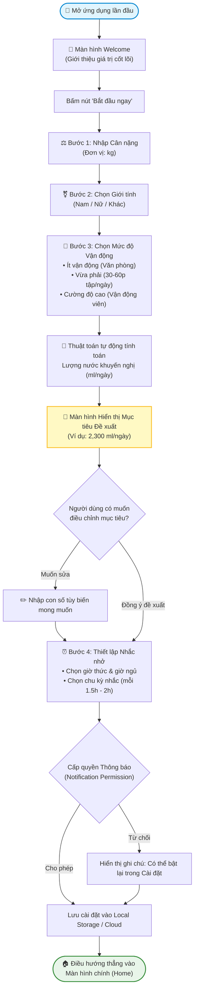
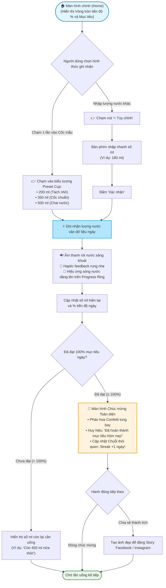
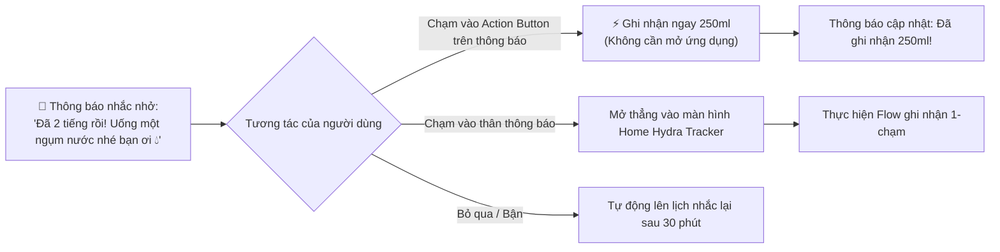

# 🔄 User Flows — Luồng Trải nghiệm Người dùng

> Tài liệu mô tả trực quan và chi tiết các bước tương tác của người dùng đối với các tính năng trọng tâm của **Hydra Tracker** thông qua sơ đồ luồng Mermaid tiêu chuẩn.

---

## 🌊 Flow 1: Thiết lập Mục tiêu Ban đầu (Onboarding & Goal Calculation)

### 1. Sơ đồ tương tác (Mermaid Flowchart)

### 2. Mô tả chi tiết từng bước:
1. **Màn hình Welcome:** Hiển thị hình ảnh minh họa trẻ trung, slogan *"Mỗi ngụm nước — Một thói quen lành mạnh"* và nút kêu gọi hành động (CTA) nổi bật.
2. **Nhập thông số thể trạng:** Giao diện dạng trượt số (wheel picker) mượt mà, hạn chế tối đa việc phải gõ bàn phím số.
3. **Hiển thị mục tiêu khoa học:** Giải thích ngắn gọn cách tính dựa trên cân nặng và vận động để người dùng an tâm về tính khoa học.
4. **Cài đặt nhắc nhở & Xin quyền:** Nhấn mạnh lợi ích: *"Bật thông báo để Hydra nhắc bạn đúng lúc khát, không làm phiền khi bạn ngủ"*.

---

## 🥤 Flow 2: Ghi nhận Nước Uống 1-Chạm & Đạt Mốc Ngày (Quick Logging & Celebration)

### 1. Sơ đồ tương tác (Mermaid Flowchart)

### 2. Xử lý các tình huống biên (Edge Cases):
- **Trường hợp bấm nhầm cốc:** Ngay sau khi ghi nhận, ở góc dưới màn hình luôn xuất hiện một thanh thông báo dạng Toast: *"Đã thêm 350 ml • [Hoàn tác / Undo]"* tồn tại trong 4 giây để người dùng bấm hủy ngay lập tức nếu lỡ tay.
- **Trường hợp uống vượt 100% mục tiêu:** Vòng tròn tiến độ sẽ chuyển sang màu xanh ngọc rực rỡ và hiển thị `115% - Vượt mục tiêu! Rất tuyệt vời nhưng hãy chú ý không uống quá tải`.

---

## ⏰ Flow 3 (Phụ trợ): Nhận Thông báo Nhắc nhở & Quick Log từ Notification

